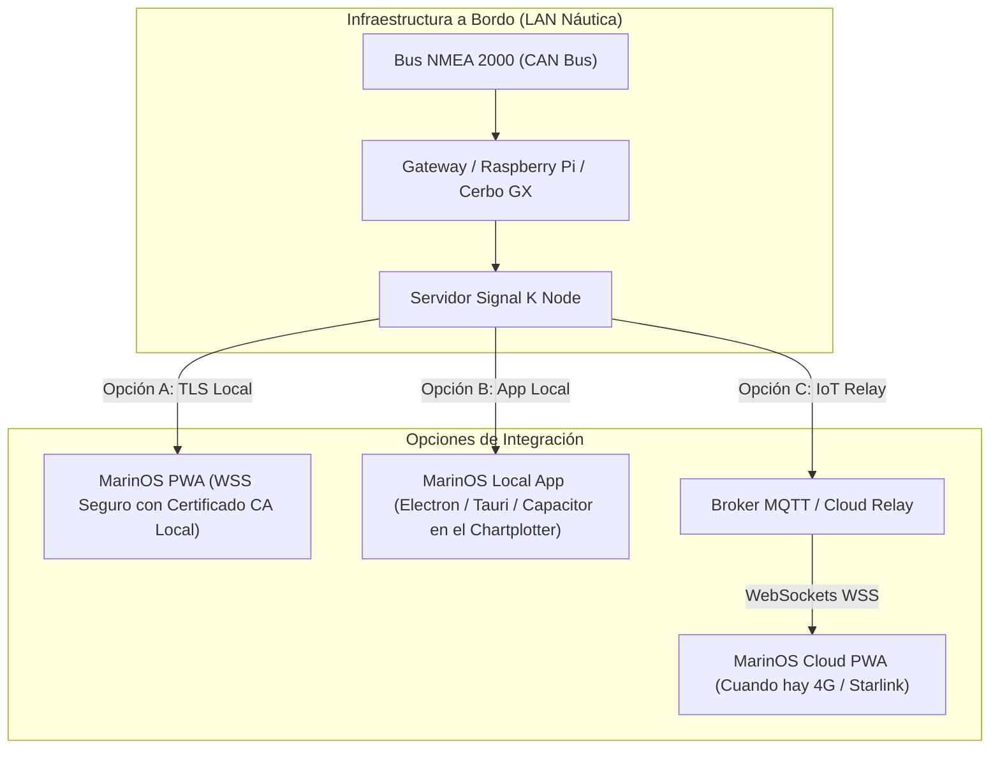

# Arquitectura a Bordo y Conectividad NMEA / Signal K — MarinOS v3

Este documento técnico detalla las restricciones de red del navegador, la topología de red marina a bordo de una embarcación en navegación (ej. Chiloé / fiordos patagónicos) y las tres soluciones viables de ingeniería para consumir datos NMEA 2000 sin comprometer la seguridad ni violar las políticas de seguridad del navegador.

---

## 1. El Problema Técnico: Restricción de Contenido Mixto y PNA

Cuando la aplicación web de MarinOS se sirve bajo **HTTPS** (ej. `https://marine-os.vercel.app` o `https://marinos.app`):

1. **Mixed Content Blocking:** El navegador (Safari en iOS/iPadOS, Chrome en Android/macOS) bloquea terminantemente cualquier petición `http://` no encriptada hacia una IP de red local (ej. `http://192.168.1.100:3000/signalk/v1/api`).
2. **Private Network Access (PNA):** Las especificaciones W3C de PNA prohíben que contextos públicos de internet inicien conexiones indiscriminadas contra subredes RFC 1918 privadas (`192.168.x.x`, `10.x.x.x`) a menos que el dispositivo local responda con encabezados CORS de pre-vuelo específicos y conexión TLS confiable.
3. **Cero Conexiones Ficticias:** MarinOS v3 prohíbe simular una conexión viva exitosa cuando el navegador está bloqueando la trama por red.

---

## 2. Opciones de Arquitectura Viables

Para comunicar la PWA de MarinOS con el bus de datos NMEA 2000 del barco (motor Yanmar, sensores de viento, sonda de profundidad, compás fluxgate), se admiten tres patrones de despliegue:

### Opción A: Gateway a Bordo con HTTPS / WSS y Certificado Local
- **Cómo funciona:** El servidor Signal K (típicamente instalado en una Raspberry Pi 4 con hat PICAN-M o un Victron Cerbo GX conectado a la red WiFi del barco) genera un certificado TLS local o utiliza mDNS (ej. `signalk.local`). Se instala una CA raíz local en el iPad/teléfono del capitán una sola vez durante el comisionamiento del barco.
- **Protocolo:** WebSocket seguro `wss://signalk.local:3443/signalk/v1/stream`.
- **Ventajas:** Latencia ultra baja (< 50 ms), 100% independiente de internet, compatible directamente con el navegador del timonel.
- **Desventaja:** Requiere un paso único de instalación del perfil de certificado en iOS/iPadOS.

### Opción B: Aplicación Nativa de a Bordo (Empaquetado Local / Chartplotter)
- **Cómo funciona:** La interfaz de MarinOS se empaqueta como aplicación nativa (Capacitor para iOS/Android o Tauri para Linux/Mac) o se sirve localmente desde el propio servidor Signal K en el puerto HTTP local `http://192.168.1.100:3000`. Al servirse desde la misma IP o como origen local seguro `capacitor://localhost`, no existen restricciones de Mixed Content.
- **Ventajas:** Cero advertencias del navegador, acceso completo a hardware Bluetooth e interfaces de red seriales.

### Opción C: Relay en la Nube desde Gateway Satelital o Celular
- **Cómo funciona:** El gateway a bordo envía periódicamente resúmenes comprimidos hacia el backend de MarinOS mediante MQTT o HTTPS cuando dispone de Starlink, enlace celular 4G o Iridium Certus.
- **Ventajas:** Permite a la base de operaciones o al armador en tierra monitorear la flota en tiempo real sin estar a bordo.
- **Desventaja:** No es adecuado para instrumental de puente en tiempo real sin conexión de satélite de baja latencia.

---

## 3. Estado de la Telemetría en MarinOS v3

- **Modo SIMULADOR (Predeterminado cuando no hay enlace físico verificado):**
  La telemetría del motor Yanmar 4JH57 y las variables físicas (RPM, presión de aceite, temperatura refrigerante, voltaje de alternador) se simulan localmente en el cliente con coherencia náutica y avance por estima (Dead-Reckoning).
- **Modo EN_VIVO:**
  Solo se activa cuando se establece un handshake exitoso vía WebSocket seguro (`wss://`) hacia un endpoint Signal K comprobado.
