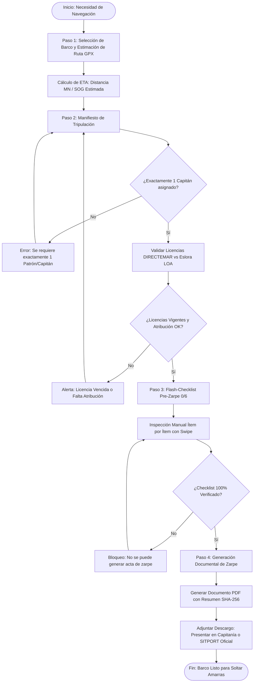
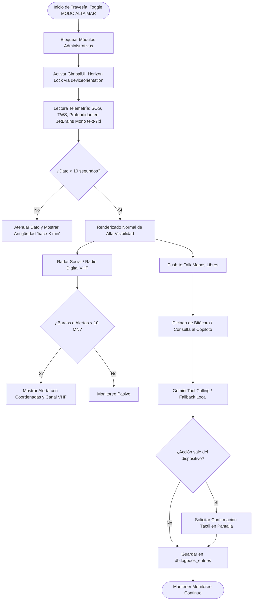
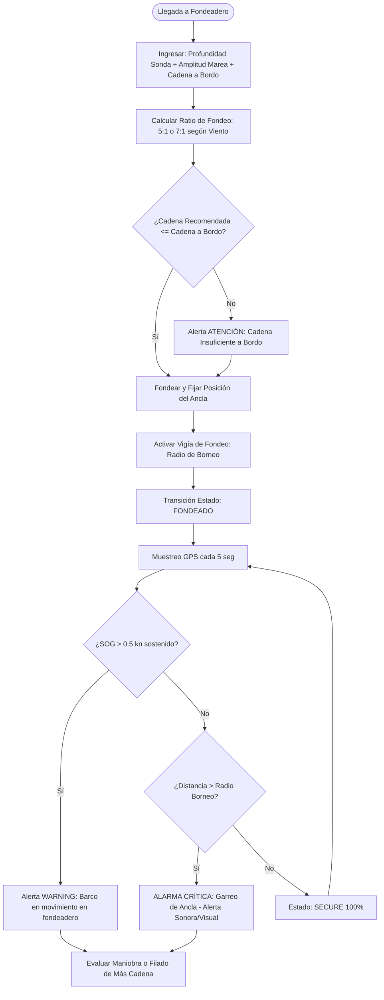
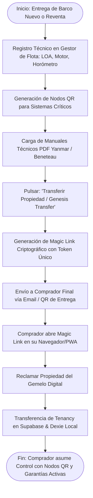
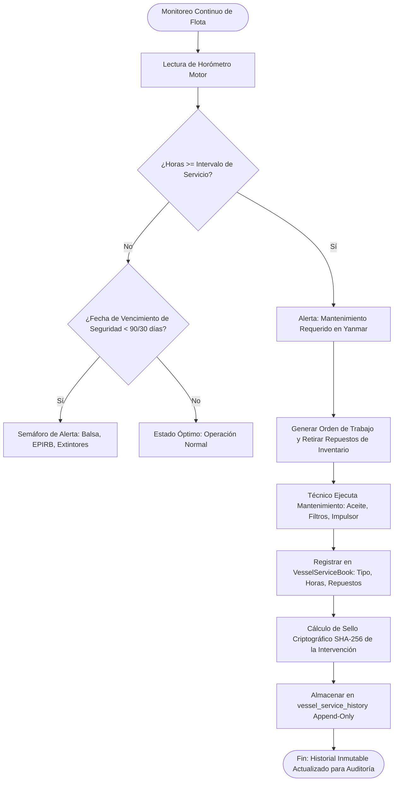
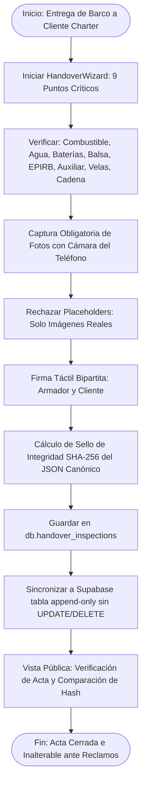

# MarinOS v3.1 — Arquitectura de Procesos BPMN y Matriz Integral de QA
> **Documento de Especificación de Procesos de Negocio (BPMN 2.0) y Auditoría de Calidad**  
> **Autor:** Lead QA Architect & Principal Systems Engineer  
> **Versión:** 3.1.0-RC  
> **Fecha:** 18 de Noviembre de 2026  
> **Alcance:** Procesos de Usuario (Operación Marítima) y Procesos de Gestión (Flota, Mantenimiento B2B y Astillero)

---

## 1. Resumen Ejecutivo de Arquitectura

MarinOS es una Progressive Web App (PWA) de alta criticidad náutica diseñada con enfoque **Local-First** (Next.js 15, Dexie IndexedDB v10, Service Worker con cache cartográfica) y sincronización oportunista hacia un backend FastAPI y Supabase PostGIS.

Para garantizar seguridad a bordo y viabilidad comercial sin incurrir en contingencias legales, el sistema se estructura en dos dominios estrictamente segregados mediante una **Arquitectura Bimodal (Tierra vs. Alta Mar)**:

```
┌─────────────────────────────────────────────────────────────────────────────┐
│                           MARINOS BIMODAL PLATFORM                           │
├──────────────────────────────────────────┬──────────────────────────────────┤
│        MODO ALTA MAR (TÁCTICO)           │        MODO TIERRA (GESTIÓN)     │
├──────────────────────────────────────────┼──────────────────────────────────┤
│ • Gimbal UI (Horizon-Lock DeviceOrientation) • Gestor de Flota & Genesis Handover  │
│ • Telemetría NMEA 2000 / Signal K        │ • Libro de Mantenimiento Inmutable │
│ • Vigía de Fondeo & Alarma de Garreo     │ • Handover Bipartito de Charter  │
│ • Radio VHF Digital (< 10 MN, 24h TTL)   │ • Agenda de Tripulación & Licencias│
│ • Flash-Checklist (Swipes estilo Tinder) │ • Split-Bill & OCR de Boletas    │
│ • SOS / MAYDAY (VHF 16, DSC, Guion)      │ • Configuración de Integraciones │
└──────────────────────────────────────────┴──────────────────────────────────┘
```

---

## 2. BPMN: Procesos de Usuario (Operación Marítima)

### 2.1 Proceso U-01: Planificación, Verificación y E-Zarpe



---

### 2.2 Proceso U-02: Navegación Táctica & Anti-Mareo en Alta Mar



---

### 2.3 Proceso U-03: Vigía de Fondeo & Alarma de Garreo



---

### 2.4 Proceso U-04: Protocolo de Emergencia SOS / MAYDAY

```mermaid
flowchart TD
    SOSBtn([Presionar Botón SOS Flotante por 3s]) --> OpenModal[Abrir Consola SOS de Emergencia]
    OpenModal --> SelectType{Seleccionar Tipo de Emergencia}
    
    SelectType -- Hombre al Agua MOB --> StepMOB[Acciones Inmediatas: Gritar, Aro Salvavidas, Apuntar, Pulsar Botón MOB]
    SelectType -- Vía de Agua --> StepLeak[Localizar Entrada, Arrancar Bombas de Achique, Espiche]
    SelectType -- Fuego / Incendio --> StepFire[Cortar Baterías/Gas, Extintor a la Base, Ponerse al Viento]
    SelectType -- Varada / Gobierno --> StepSteer[Verificar Vía de Agua, Sondeo de Fondo, Invertir Máquina]
    
    StepMOB --> DSCStep[Paso Obligatorio: Levantar Tapa Roja y Pulsar DISTRESS en VHF DSC]
    StepLeak --> DSCStep
    StepFire --> DSCStep
    StepSteer --> DSCStep
    
    DSCStep --> VoiceMayday[Guion Fonía VHF Canal 16: MAYDAY x3 con MMSI, Nombre y Coordenadas DMS]
    VoiceMayday --> SatCheck{¿Hardware Satelital Vinculado?}
    
    SatCheck -- No --> DisableSat[Botón Satelital DESHABILITADO: 'Alerta Satelital No Disponible']
    SatCheck -- Sí --> DispatchSBD[Transmisión SBD Corta vía Iridium/Garmin]
    
    DisableSat --> StandbyMayday([Mantener Escucha VHF 16 / Espera de Auxilio])
    DispatchSBD --> StandbyMayday
```



---

## 3. BPMN: Procesos de Gestión de Flota y Empresa (B2B)

### 3.1 Proceso G-01: Genesis Handover (Astillero / Dealer -> Propietario)



---

### 3.2 Proceso G-02: Ciclo de Mantenimiento e Historial Inmutable



---

### 3.3 Proceso G-03: Handover de Alquiler / Charter (Entrega y Recepción)



---

## 4. Matriz de Auditoría QA Experta (QA Gap Analysis)

| ID Requisito | Módulo | Estado Actual | Brecha Faltante (Gap) | Criterio de Aceptación QA (Gherkin / DoD) |
|---|---|---|---|---|
| **R-4.1.1** | Global | Implementado (`dataMode: 'SIMULADO' \| 'EN_VIVO'`) | Franja de advertencia activa. Requiere persistencia en sesión. | **GIVEN** dataMode === 'SIMULADO' **THEN** franja roja/ámbar visible en toda vista. |
| **R-4.1.3** | UI Copy | Limpio (0 instancias de "LIVE" sin respaldo) | Validar que no reaparezcan en actualizaciones futuras. | **GIVEN** inspección de código **THEN** grep de "LIVE" o "Verificado" retorna 0 resultados. |
| **R-4.2.2** | Fondeo | Implementado (`evaluateAnchorWatch`) | Requiere simulación de deriva sostenida en tests automáticos. | **GIVEN** SOG > 0.5 kn **THEN** estado nunca puede ser 'SECURE'. |
| **R-4.4.2** | Zarpe | Implementado (PDF Borrador Oficial) | Integración con portal SITPORT pendiente de API oficial DIRECTEMAR. | **GIVEN** generación de zarpe **THEN** documento indica claramente 'Borrador para Autoridad'. |
| **R-4.5.3** | SOS | Implementado (Guion MAYDAY con MMSI) | Dependencia de hardware VHF físico del usuario. | **GIVEN** modal SOS activa **THEN** guion incluye MMSI y posición en grados y minutos. |
| **R-4.5.5** | SOS | Implementado (Botón Satelital deshabilitado) | Falta conector WebUSB / Bluetooth para Garmin inReach. | **GIVEN** sin hardware satelital **THEN** botón disabled con aviso explícito. |
| **R-4.6.1** | Fondeo | Implementado (`calculateAnchorScope`) | Validado con campo `chain_length_meters`. | **GIVEN** cadena requerida > disponible **THEN** estado pasa a 'ATENCIÓN'. |
| **R-4.8.1** | Carta | Implementado (Disclaimer náutico SHOA) | Falta descarga de teselas offline en Service Worker para toda la X Región. | **GIVEN** visualización de carta **THEN** descargo de responsabilidad permanente. |
| **R-4.9.1** | Inventario| Implementado (Alertas 90/30 días) | Integración con catálogo de distribuidores locales (Puerto Montt). | **GIVEN** fecha de expiración < 30 días **THEN** semáforo en rojo. |
| **R-4.10.3**| Traspaso | Implementado (SHA-256 canónico) | Sincronización a Supabase requiere tabla PostGIS append-only. | **GIVEN** acta firmada **THEN** hash SHA-256 coincide exactamente al verificar. |
| **R-4.11.4**| Cuentas | Implementado (Datos demo ficticios) | Verificado: eliminados correos y RUTs personales reales. | **GIVEN** seeds y fallbacks **THEN** usan `demo@marinos.app` y `11.111.111-1`. |
| **R-4.13.2**| Copiloto | Implementado (Gemini Tool Calling + Fallback) | RAG de manuales completos en PDF requiere vector store en Supabase pgvector. | **GIVEN** sin API key configurada **THEN** opera en modo local rotulado como demo. |

---

## 5. Hoja de Ruta para Certificación Final (Checklist de Salida)

1. [x] **Fase 0: Honestidad y Seguridad:** Eliminación de afirmaciones legales falsas, rotulado de simulación, sanitización de datos de demo.
2. [x] **Fase 1: Coherencia de Datos:** Cálculo dinámico de ruteo, trigonometría de viento aparente, máquina de estados náuticos.
3. [x] **Fase 2: Arquitectura Bimodal:** Conmutador Tierra vs Alta Mar, Gimbal UI Horizon Lock, tipografía gigante de telemetría.
4. [x] **Fase 3: Flash-Checklist:** Deslizamiento de tarjetas Tinder-style para tripulación y motores.
5. [x] **Fase 4: Comunicación Táctica:** Push-to-Talk manos libres, Radio Comunidad con filtrado geográfico < 10 MN y expiración 24h.
6. [ ] **Fase 5 (Hardware Real - Próximo Hito):** Integración física con Actisense NGT-1 NMEA 2000 vía WebSerial o gateway WSS local a bordo.
7. [ ] **Fase 6 (Regulatorio):** Convenio de pruebas con DIRECTEMAR para transmisión digital cuando se publique la API gubernamental.
